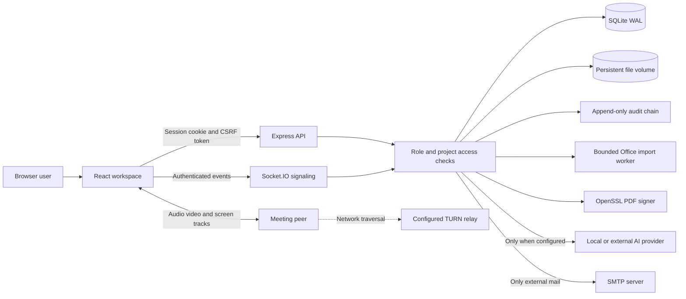

# Architecture

One company per deployment. React/TypeScript supplies the common shell and application modules. Express and Socket.IO enforce identity and access to persistent SQLite records and uploaded blobs. This version deliberately chooses a single process and persistent disk to make local operation simple and reviewable.

## Source map

- `server/app.js`: routes, sessions, authorization, workflow transitions, integration entry points.
- `server/store.js`: SQL schema, parameterized statements, transactions, scrypt passwords, audit chaining.
- `server/domain.js`: typed input validation, bounded formulas, working-day and leave calculations.
- `server/exports.js`: public-format exports and text/data imports.
- `server/import-safe.js`: worker lifetime, memory and time limits.
- `server/signing.js`: PKCS#12 extraction and detached CMS signature through OpenSSL, with temporary-file cleanup.
- `server/index.js`: runtime lifecycle and authenticated real-time signaling.
- `src/App.tsx`: navigation, overview, Drive, projects, company pages, mail, PDF workbench and AI sidebar.
- `src/Editors.tsx`: writing, spreadsheet and presentation editors.
- `src/Collaboration.tsx`: channels, calendar and WebRTC peer connections.
- `src/Operations.tsx`: timesheets, leave, reports and administration.

## Trust boundaries

1. Authentication is an opaque, random, httpOnly, SameSite=strict session cookie. Only its SHA-256 digest is stored. Sessions expire after eight hours. All mutations require the server-issued CSRF token. Production cookies require TLS.
2. All project access is checked against current membership at request time. Users cannot submit their own role, owner or approver fields through generic entity mutations. Hourly rates are omitted from member project views.
3. Private files/documents belong to their owner. Project files are editable by accessible project members. Pages and channels without a project are intentionally company-wide. Mail is restricted to sender and internal recipient.
4. Submitted time and approved leave use explicit review endpoints. A reviewer cannot approve their own request. Approval freezes client rate, currency and PO details for reports.
5. AI receives a bounded selection of records the current user can access. It returns text; no AI tool dispatch exists. Stored content is explicitly treated as untrusted context.
6. Office imports run in disposable workers, reject oversized/invalid ZIP metadata and disallow document-type declarations. Uploaded files are served as downloads; only PDFs can be previewed. Upload quotas/AV scanning are a deployment extension, not silently assumed.
7. Audit records cannot be updated/deleted through SQL while the provided triggers remain. Hashes chain record metadata; exported head hashes must be retained externally to detect a privileged host rewrite.

## Storage and concurrency

Entities use a validated JSON payload plus SQL columns for kind, owner, version and timestamps. Version checks and audit writes occur in one SQLite transaction. In-process business validation and writes are synchronous. The deployment uses `Recreate`, one replica and one ReadWriteOnce PVC. Concurrent editing detects conflicts rather than merging changes or implementing CRDT coauthoring.

## Extension boundary

`server/index.js` optionally loads `server/romania.js` when present. This file and the billing UI exist only on the Romania branch. General entity endpoints do not expose extension collections because only explicitly declared schemas are accepted.
